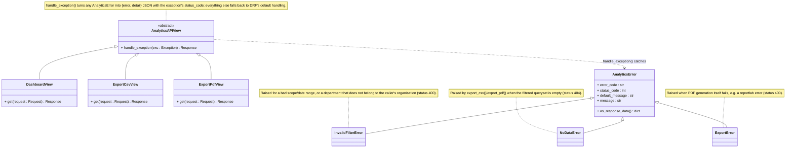
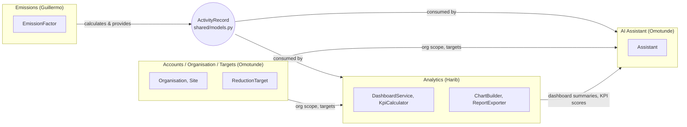

# CarbonDesk

## Team and project information

**Project:** CarbonDesk, Enterprise Carbon Footprint Tracker & AI Assistant
**Course:** Python Capstone Project, M.Sc. Digital Transformation, FH Dortmund
**Lecturer:** Prof. Galyna Tabunshchyk
**Semester:** Winter 2026/27

CarbonDesk is a web platform that helps small and medium companies measure their
Scope 1, 2 and 3 greenhouse gas emissions. Users record business activities such as
fuel use, electricity and business travel, which are converted to CO2e with traceable
emission factors. A dashboard shows where emissions come from and how they change over
time, reduction targets are tracked per scope, and an AI assistant explains the results
and suggests practical ways to reduce emissions.

**Tech stack:** Python 3.13, Django, Django REST Framework, NiceGUI, Plotly,
PostgreSQL / MySQL / SQLite, Google Gemini API, Docker, pytest

### Team overview

| Name | Matriculation no. | Subsystem |
|---|---|---|
| Harib Khalid | 7225862 | Analytics Dashboard & Reporting |
| Guillermo Pérez Pérez | 7227515 | Emissions Data & Calculation |
| Omotunde Sholola Ganiyu | 7227720 | Users, Organisation & Targets; AI Sustainability Assistant |

CarbonDesk is our Compact Programming capstone project at FH Dortmund. We are
building a web platform for small and medium companies to track Scope 1, 2,
and 3 carbon emissions, view their results, and get AI suggestions for reducing
their footprint.

## Hometasks videos
[Hometask 1](https://drive.google.com/file/d/1lnminqtsOiUDFpo5AU4d-n9aW0n23gPX/view?usp=drive_link)
[Hometask 2](https://drive.google.com/file/d/1vSnj48LUbQVJDBbEYKEqYcn1fh1l2RzW/view?usp=drive_link)
[Hometask 3](https://drive.google.com/file/d/18hpc8EBgo4YM00Iat56wUgKBvHRh2cKu/view?usp=drive_link)
[Hometask 4](https://drive.google.com/file/d/106W1iN7vCgCEsEyJsNdvI5q3gFeVKJFi/view?usp=drive_link)

## Planned stack

| Technology | Purpose |
| --- | --- |
| Python | Main language for the backend and frontend. |
| Django | Backend logic, data validation, authentication, permissions, and database models through its ORM. |
| NiceGUI | Web interface with activity forms, CSV uploads, tables, dashboards, and an assistant chat. |
| PostgreSQL | Shared database for organisations, activity records, emission factors, targets, and chat history. |
| Plotly | Interactive emissions charts and trends. |
| Google Gemini API | Explanations and reduction suggestions based on company emissions data. |
| Docker Compose | Run the application components and database together. |
| pytest | Automated tests for calculations and application behavior. |

Django handles the business rules and data access; NiceGUI provides the user
interface.

## Who does what

| Team member | Subsystem | Main responsibilities |
| --- | --- | --- |
| Guillermo Pérez Pérez | Emissions Data & Calculation | Activity entry and CSV import, input validation, emission factors, and conversion to kg CO2e. |
| Harib Khalid | Analytics Dashboard & Reporting | Charts, KPIs, filters, target progress, and PDF/CSV reports. |
| Omotunde Sholola Ganiyu | AI Sustainability Assistant | Company-data chat, reduction recommendations, savings estimates, and monthly summaries. |
| Omotunde Sholola Ganiyu | Users, Organisation & Targets | Login and roles, company structure, yearly reduction targets, alerts, and audit history. |

The team coordinates shared data models and interfaces so the subsystems work
together.

## Project structure

```text
backend/
  config/          Django settings and root URLs
  core/            Shared health endpoint
  emissions/       Guillermo: activity records and calculations
  analytics/       Harib: summaries and reports
  assistant/       Omotunde: AI services
  accounts/        Omotunde: users, organisations and targets
frontend/
  pages/           Matching NiceGUI pages for each subsystem
  api.py           Server-side HTTP calls to Django
  layout.py        Shared navigation and page layout
requirements/      Backend and frontend dependencies
compose.yaml       Local Docker setup
compose.dev.yaml   Optional source mounts and automatic reload
```

Each Django subsystem has `models.py`, `services.py`, `views.py`, and `urls.py`.
Keep calculations and business rules in backend services. The frontend calls
Django through HTTP and must not access the database directly. The shared
`GET /api/health/` endpoint is the first working connection between them.

## Run with Python

Use **Python 3.13** and standard `venv`/`pip`. Run commands from the repository
root. No uv installation is required.

```bash
python3.13 -m venv .venv
source .venv/bin/activate
python -m pip install -r requirements-dev.txt
cp .env.example .env
python backend/manage.py migrate
python backend/manage.py runserver
```

On Windows PowerShell, replace the environment creation, activation, and copy
commands with:

```powershell
py -3.13 -m venv .venv
.\.venv\Scripts\Activate.ps1
Copy-Item .env.example .env
```

Open a second terminal, activate the same environment, and start the frontend:

```bash
python -m frontend.main
```

- Frontend: http://localhost:8080
- Backend health: http://localhost:8000/api/health/
- Django admin: http://localhost:8000/admin/

The Python setup uses SQLite by default. To use an existing PostgreSQL database,
set `DB_ENGINE=postgresql` and the `POSTGRES_*` values in `.env` before migrating.
The frontend reads `BACKEND_URL` from `.env`. Environment variables take priority.

To create a local admin account:

```bash
python backend/manage.py createsuperuser
```

## Run with Docker Compose

Install Docker with the Compose plugin (Docker Desktop includes it). From the
repository root:

```bash
cp .env.example .env
docker compose up --build
```

On Windows use `Copy-Item .env.example .env`. Keep an existing `.env` rather than
copying over your settings. Compose starts PostgreSQL, applies Django migrations,
and starts the backend and frontend. The same browser URLs above apply.
PostgreSQL data and uploaded files use named volumes. The database is only
accessible inside the Compose network.

For automatic reload while editing Python files:

```bash
docker compose -f compose.yaml -f compose.dev.yaml up --build
```

Useful commands:

```bash
docker compose exec backend python manage.py createsuperuser
docker compose exec backend python manage.py makemigrations
docker compose exec backend python manage.py migrate
docker compose logs -f
docker compose down
```

`docker compose down` keeps the data volumes. Adding `--volumes` deletes them.
Stop the Python servers before starting Compose to avoid port conflicts.
These Docker files are for local development and demos: they use Django's
development server and local credentials, not a production deployment.

### AI assistant configuration (Google Gemini)

The assistant sends company emissions summaries to the Google Gemini API through
the documented `generateContent` REST interface
(https://ai.google.dev/api/generate-content) and returns only the answer text.
The API key travels in the `x-goog-api-key` request header, never in the URL.
Current model names are listed at https://ai.google.dev/gemini-api/docs/models.

Settings in `.env` (`.env.example` lists them with placeholder values only, so
no real key is stored in the repository):

| Variable | Meaning | Default |
| --- | --- | --- |
| `GEMINI_API_KEY` | API key from Google AI Studio. Leave empty to run without AI. | empty |
| `GEMINI_MODEL` | Gemini model used for chat and monthly summaries. | `gemini-3.1-flash-lite` |
| `GEMINI_TIMEOUT_SECONDS` | Request timeout for one model call, in seconds. | `30` |

If you migrate from an older checkout, remove the previous `OPENAI_API_KEY`,
`OPENAI_MODEL`, and `OPENAI_TIMEOUT_SECONDS` lines from your `.env`; they are no
longer read. Keep real keys in `.env` only and never commit that file.

Without a key the assistant keeps working: chat and monthly summaries fall back
to rule-based answers built from the recorded emissions data. Savings estimates
are always calculated by the backend, with or without AI.

The backend dependencies changed with this migration, so rebuild the backend
image after pulling new code: `docker compose up --build`. Compose passes the
settings above to the backend container when it starts. The test suite mocks
AI requests and blocks unmocked calls through the adapter, so assistant tests
need no key and cannot send live AI requests. A local live-key check also
confirmed chat responses with synthetic emissions data using `gemini-3.1-flash-lite`.

## Working together

- Add models and business logic in your Django subsystem and UI in the matching
  `frontend/pages/` module. Coordinate changes to shared models and settings.
- After changing models, run `python backend/manage.py makemigrations`, then
  `python backend/manage.py migrate`. Commit the generated migrations.
- Keep dependency changes in the appropriate `requirements/` file and reinstall
  with `python -m pip install -r requirements-dev.txt`.
- Keep secrets in `.env`; it is ignored by Git. Add new configuration names with
  safe example values to `.env.example`.
- Agree authentication and organisation checks before exposing company data.
  The starter health endpoint is public and contains no company data.

Run checks from an activated environment:

```bash
python backend/manage.py check
python -m pytest
python -m ruff check .
python -m ruff format --check .
```

## Current status

Implemented: **Users, Organisation & Targets** and the **AI Sustainability
Assistant**. The emissions page now supports factor creation, activity entry,
CSV import, calculation previews, filtered records, and totals. The dashboard at
http://localhost:8080/dashboard shows KPIs (including a 0-100 sustainability
score), emissions by scope, a monthly trend, emissions by site and by
department, the top sources and target progress, with filters (including a
department filter) and CSV/PDF export.

- Register a company at http://localhost:8080/register; you become its administrator.
- Roles: `admin` manages the organisation, members and targets; `editor` enters
  data; `viewer` has read-only access.
- No Gemini key is needed. Without `GEMINI_API_KEY` the assistant answers from
  rules; savings estimates are always calculated by the backend, not the model.

### Shared building blocks for every subsystem

- **API style:** Django REST Framework with token authentication. Every endpoint
  requires login by default. The frontend sends the token through `frontend/api.py`
  (`await api.get("emissions/...")`), which raises `ApiError` with a readable message.
- **Company data isolation:** combine `accounts.mixins.OrganisationScopedMixin` with a
  permission from `accounts.permissions` (for example `CanEditDataOrReadOnly`). The
  mixin filters querysets by `organisation`, attaches new records to the user's
  organisation and writes the audit history automatically.
- **Emissions totals:** targets and the assistant read emissions through
  `core/emissions_data.py`. The emissions subsystem provides
  `emissions.services.totals_by_scope(organisation, start, end)`, returning
  `{1: Decimal, 2: Decimal, 3: Decimal}` in kg CO2e from saved activities.
  The date range includes `start` and excludes `end`.

### Main endpoints

| Area | Endpoints under `/api/` |
| --- | --- |
| Authentication | `accounts/register/`, `accounts/login/`, `accounts/logout/`, `accounts/me/` |
| Organisation | `accounts/organisation/`, `accounts/sites/`, `accounts/members/` |
| Targets & alerts | `accounts/targets/`, `accounts/targets/evaluate/`, `accounts/alerts/`, `accounts/audit-log/` |
| Emissions | `emissions/factors/`, `emissions/activities/`, `emissions/activities/import/`, `emissions/preview/`, `emissions/summary/` |
| Analytics | `analytics/dashboard/`, `analytics/export/csv/`, `analytics/export/pdf/` (all accept `start`, `end`, `scope`, `site`, `department`) |
| Assistant | `assistant/conversations/`, `assistant/conversations/<id>/messages/`, `assistant/recommendations/`, `assistant/summaries/` |

Implemented UML diagrams and the team presentation video link will be added as
development progresses.

## First emissions workflow

1. Apply migrations with `python backend/manage.py migrate` (Compose applies them
   at startup). Register a company or log in with its admin/editor account.
2. An administrator adds a site on the Organisation page.
3. On **Emissions → Emission factors**, add a factor with its name, scope, unit,
   value in kg CO2e per unit, source, and year.
4. Choose **Add activity**, select the site and factor, and enter the date and
   quantity. Preview the calculation, then save it. Alternatively, choose
   **Import CSV** to add many activities from one file.
5. Browse the records, filter by date/scope/site, and open **Details** to inspect
   the inputs used. Admins/editors can choose **Edit activity** or **Delete activity**
   here. Deletion asks for confirmation. Saved totals also feed the assistant and targets.

For a reproducible example, use a separate demo organisation and add a factor
named **Demo electricity**, Scope 2, unit `kWh`, value `0.4`, source **Synthetic
example**, year `2026`. Select **This is a synthetic demo factor**. An activity
of `100 kWh` must preview and save as **40.00 kg CO2e**. These numbers are for
software testing, not an official emissions estimate. Demo records are labelled
on the emissions page but still contribute to company totals, including the
assistant and targets; keep demo activity separate from real company data.

### Endpoint behavior

- `GET/POST /api/emissions/factors/`: list or add company factors. Each new
  source/version can be a separate factor. PATCH/PUT on `factors/<id>/` corrects
  a factor while keeping its unit and scope fixed. Saved activities stay unchanged.
- `POST /api/emissions/factors/<id>/recalculate/`: explicitly apply the current
  factor to all linked company activities, across all dates/sites. Send the latest
  GET factor object as `{"factor": {...}}`; stale confirmations return HTTP 409.
  The operation is atomic and retains before/after activity snapshots in the audit log.
  Admins/editors can update and recalculate; viewers cannot. Factor deletion is not exposed.
- `POST /api/emissions/preview/`: send `factor`, `quantity`, and `unit`; receive
  `kg_co2e` without saving a record. Include an `activity` ID when editing to
  preview its saved factor inputs if the factor selection is unchanged.
- `GET/POST /api/emissions/activities/`: list or create records. Creation accepts
  `description`, `date` (`YYYY-MM-DD`), `factor` ID, `site` ID, `quantity`, and
  `unit`. The backend assigns the company, creator, scope, and result.
- `GET /api/emissions/activities/<id>/`: inspect the saved calculation inputs.
- `PATCH/PUT /api/emissions/activities/<id>/`: correct an activity and recalculate.
  PATCH accepts only changed fields; PUT requires all entry fields. When selecting
  a factor with a different unit, send that unit too.
- `DELETE /api/emissions/activities/<id>/`: remove an activity from totals (HTTP 204).
  Admins/editors may edit/delete; viewers cannot. Before/after edit snapshots and
  deleted record details remain in the existing audit log, atomically with the change.
  Edits keep the saved factor version unless a different factor is selected.
  The creator and creation date remain unchanged. There is no restore button.
- `POST /api/emissions/activities/import/`: upload a CSV file in the `file`
  multipart field. The response reports how many records were created.
- `GET /api/emissions/summary/`: record count, demo count, total and scope totals.

Activity lists and summaries accept `start` (inclusive), `end` (exclusive),
`scope` (1–3), and `site`. Lists use 20 records per page and accept `page`.
Omitted date filters include all dates. Invalid filters return HTTP 400.
Admins/editors can add factors, add activities, and import CSV; viewers can read
and preview. All endpoints require an organisation membership. Cross-company IDs
are rejected.

Quantities must be non-negative and have at most four decimal places; factors
allow eight. Zero is valid. Units must match exactly: conversions are not implicit.
Activity dates cannot be in the future. The calculation uses `Decimal` and rounds
half up to **0.01 kg CO2e** once per record; totals sum those saved results.
Records preserve the factor name, scope, value, unit, source, year, and demo flag
used in the latest calculation. Recalculation replaces these snapshots while
retaining the previous values in the audit log. Writes use the existing audit log.

### CSV import

The **Import CSV** button accepts UTF-8 files with a header row. Required columns
are `date`, `description`, `site`, `factor`, `quantity`, and `unit`. The optional
`factor_year` column selects one version when several factors share a name. Dates
use `YYYY-MM-DD`; site and factor names must match the company exactly.

Validation is all-or-nothing: if any row fails, no records are saved and the
response lists each problem with its physical line number (up to 100 problems
are shown). Imports are limited to 5 MB and 5,000 data rows. Each imported record is calculated with the same
rules as manual entry and receives its own audit-log entry. The import does not
check for duplicate activities, so re-uploading a file creates the rows again.
A template is available from the import dialog.

## Hometask 2: Stream processing

`stream_processing/` is a plain-Python, framework-free pipeline for the Enterprise
Carbon Footprint Tracker topic: it ingests telemetry (flight bookings, data-center
power logs, freight payloads), filters it by scope tag, and converts quantities to
CO2e. It has no Django imports and no database access.

`ActivityEvent` (in `base.py`) is a real subclass of the project's shared
[`ActivityRecord`](#shared-data-model-team-proposal): it inherits every record
field (`scope`, `category`, `quantity`, `unit`, `site`, `kg_co2e`, ...) and adds
only what a live telemetry event needs that a stored record doesn't (`event_id`,
`source`, `timestamp`, `metadata`). Fields a raw event can't know yet
(`organisation_id`, `site`, `date`, `factor_value`, `kg_co2e`) get defaults, and
`tco2e` is overridden to stay `None` until `CO2eTransformer` fills in `kg_co2e` -
a second example of polymorphism alongside the `StreamProcessor` subclasses.

| File | Subsystem | Contents |
| --- | --- | --- |
| `stream_processing/base.py` | Shared (whole team) | `ActivityEvent`, `StreamProcessor` ABC, `Pipeline`, `EventSource` |
| `stream_processing/emissions_processors.py` | Emissions (Guillermo) | `ScopeFilter`, `CO2eTransformer` — extend here |
| `stream_processing/analytics_processors.py` | Analytics (Harib) | `ScopeTotalsAggregator`, `WindowedKpi`, `PeakDetector` |
| `stream_processing/accounts_processors.py` | Users, Organisation & Targets (Omotunde) | `OrganisationFilter`, `TargetAlertProcessor` |
| `stream_processing/assistant_processors.py` | AI Assistant (Omotunde) | `SavingsEstimator`, `HotspotRecommender` |
| `stream_processing/demo.py` | — | Synthetic telemetry and a full pipeline run |

Stages chain with the `|` operator, left to right, and compose lazily (nothing is
buffered in memory):

```python
source | ScopeFilter({1, 2}) | CO2eTransformer(factors) | ScopeTotalsAggregator()
```



```mermaid
classDiagram
    class ActivityRecord {
        + organisation_id : int
        + site : str
        + date : date
        + scope : int
        + category : str
        + quantity : Decimal
        + unit : str
        + factor_value : Decimal
        + kg_co2e : Decimal
        + id : int
        + get_tco2e() Decimal
    }
    class ActivityEvent {
        + event_id : str
        + source : str
        + timestamp : datetime
        + metadata : dict
        + get_tco2e() Decimal
    }
    class StreamProcessor {
        <<abstract>>
        + process(events : Iterable) Iterator
        + #95;#95;iter#95;#95;() Iterator
        + #95;#95;or#95;#95;(other : StreamProcessor) Pipeline
        + #95;#95;ror#95;#95;(events : Iterable) Pipeline
    }
    class Pipeline {
        + stages : List~StreamProcessor~
        + process(events : Iterable) Iterator
    }
    class EventSource {
        + #95;#95;iter#95;#95;() EventSource
        + #95;#95;next#95;#95;() ActivityEvent
    }
    class ScopeFilter {
        + scopes : Set~int~
        + process(events : Iterable) Iterator
    }
    class CO2eTransformer {
        + factors : Dict~str, Decimal~
        + process(events : Iterable) Iterator
    }
    class ScopeTotalsAggregator {
        + totals : Dict~int, Decimal~
        + process(events : Iterable) Iterator
    }
    class WindowedKpi {
        + window : int
        + process(events : Iterable) Iterator
    }
    class PeakDetector {
        + threshold : Decimal
        + process(events : Iterable) Iterator
    }
    class OrganisationFilter {
        + organisation_id : int
        + process(events : Iterable) Iterator
    }
    class TargetAlertProcessor {
        + target_kg_co2e : Decimal
        + warning_ratio : Decimal
        + running_kg_co2e : Decimal
        + process(events : Iterable) Iterator
    }
    class SavingsEstimator {
        + reduction_shares : Dict~str, Decimal~
        + process(events : Iterable) Iterator
    }
    class HotspotRecommender {
        + share_threshold : Decimal
        + min_events : int
        + suggestions : Dict~str, str~
        + process(events : Iterable) Iterator
    }
    class ReductionTarget {
        <<interface>>
        + scope : str
        + target_year : int
        + get_target_kg_co2e() Decimal
    }

    ActivityRecord <|-- ActivityEvent
    StreamProcessor <|-- Pipeline
    StreamProcessor <|-- ScopeFilter
    StreamProcessor <|-- CO2eTransformer
    StreamProcessor <|-- ScopeTotalsAggregator
    StreamProcessor <|-- WindowedKpi
    StreamProcessor <|-- PeakDetector
    StreamProcessor <|-- OrganisationFilter
    StreamProcessor <|-- TargetAlertProcessor
    StreamProcessor <|-- SavingsEstimator
    StreamProcessor <|-- HotspotRecommender
    Pipeline "1" o-- "1..*" StreamProcessor : stages
    EventSource "1" ..> "0..*" ActivityEvent : yields
    ScopeFilter ..> ActivityEvent : reads scope
    CO2eTransformer ..> ActivityEvent : sets kg_co2e
    ScopeTotalsAggregator ..> ActivityEvent : reads kg_co2e, tco2e
    WindowedKpi ..> ActivityEvent : reads kg_co2e, tco2e
    PeakDetector ..> ActivityEvent : reads tco2e
    OrganisationFilter ..> ActivityEvent : reads organisation_id
    TargetAlertProcessor ..> ActivityEvent : reads kg_co2e
    TargetAlertProcessor ..> ReductionTarget : budget from
    SavingsEstimator ..> ActivityEvent : sets metadata
    HotspotRecommender ..> ActivityEvent : reads category, kg_co2e
    note for ReductionTarget "Accounts subsystem, accounts.models.ReductionTarget"
    note for ActivityRecord "Shared model, shared/models.py - also the Emissions subsystem's persisted shape"
    note for ActivityEvent "Overrides get_tco2e(): stays None until CO2eTransformer sets kg_co2e. organisation_id, site, date, factor_value default to None/empty - not known when an event is created."
```

Every attribute above is a plain public field, set once when the object is built
and never mutated through a setter (the pipeline stages are configured once, not
edited in place) — except `tco2e`, a read-only computed property
(`get_tco2e() : Decimal`) that `ActivityEvent` overrides to handle an unset
`kg_co2e`, and `kg_co2e` itself, which `CO2eTransformer` fills in as the one
write after construction.

Omotunde's stages work on the same shared `ActivityEvent` fields and stay in
kg CO2e. `OrganisationFilter` keeps one company's events (the streaming version of
the web app's data isolation). `TargetAlertProcessor` yields one `warning` alert
when the running `kg_co2e` reaches 80% of a reduction target's yearly budget, and
one `critical` alert when it passes it. `SavingsEstimator` adds an estimated saving
to `metadata`. `HotspotRecommender` yields advice once one category causes a large
share of emissions. Like `ScopeTotalsAggregator.totals`,
`TargetAlertProcessor.running_kg_co2e` is running state that the stage updates
while it processes:

```python
company = source | OrganisationFilter(1) | CO2eTransformer(factors)
alerts = company | TargetAlertProcessor(target_kg_co2e="500")
advice = company | SavingsEstimator(shares) | HotspotRecommender(share_threshold="0.4")
```

Run the demo and the tests from the repository root (same virtual environment as
the rest of the project):

```bash
python -m stream_processing.demo
python -m pytest stream_processing
```

Video: [link to be added]

## Analytics: reporting, scoring and error handling

PDF export, the sustainability score, the department breakdown/filter and clean
JSON error handling (`backend/analytics/exceptions.py`) for the dashboard and
export endpoints.



`ExportPdfView` builds on `services.export_pdf()`, which reuses the same
aggregations as the dashboard (`scope_totals`, `totals_by_site`,
`totals_by_department`, `top_sources`, `targets_overview`) to render a PDF with
`reportlab` instead of returning JSON, then base64-encodes it inside the JSON
envelope the same way `export_csv()` already does. `services.sustainability_score()`
scores progress toward the organisation's "all scopes" target the same way the
Hometask 1 UML's `KpiCalculator.score` idea did: a single 0-100 number, clamped
to that range, `None` when there is no target to score against.

## Shared data model (team proposal)

Our professor's feedback was that the project has too many different data
formats for the same thing, and no connected concept of the system across
subsystems. For Analytics, one activity record existed in three shapes: the
Django model `backend.emissions.models.ActivityRecord` (`kg_co2e`), plain dicts
in `backend/analytics/domain.py`, and the `ActivityEvent` dataclass here.

`shared/models.py` is a proposal to fix that: one plain-Python `ActivityRecord`
dataclass with field names that match the Django model exactly
(`organisation_id`, `site`, `date`, `scope`, `category`, `quantity`, `unit`,
`factor_value`, `kg_co2e`), storing emissions in kg CO2e everywhere with a
read-only `tco2e` property for metric tons. It has no Django dependency, so any
subsystem can import it (`pythonpath = ["backend", "."]` already makes
`shared.models` importable from both `backend/` and `stream_processing/`).

On the Analytics side, `backend/analytics/domain.py` (Hometask 1) and
`stream_processing/base.py`'s `ActivityEvent` (Hometask 2, this branch) both now
use these exact field names, so an activity record means the same thing
wherever it shows up in Analytics code. **Proposal for the team:** Emissions and
Accounts/AI Assistant code should read and write the same shape instead of their
own dicts/tuples, so the whole project — not just Analytics — agrees on one
format for an activity record.

## System architecture (team proposal)

**This section is a proposal for the whole team, not yet implemented outside
Analytics.** It responds to the feedback that the subsystems' interfaces aren't
connected into one system concept.



Emissions calculates and owns `ActivityRecord` (quantity, factor, `kg_co2e`);
Analytics and the AI Assistant only ever consume it, through the shared shape
above, instead of each inventing their own copy. Accounts/Targets provides the
organisation scope and reduction targets that Analytics and the AI Assistant
read but don't own. This diagram is deliberately at the subsystem level, not
the class level — see the Hometask 1 and Hometask 2 sections above for the
class-level UML within Analytics, including the `<<interface>>` boxes for
`ActivityRecord`, `Organisation`, and `ReductionTarget`.

## Emissions integration with the shared stream

Guillermo's `backend/emissions/streaming.py` uses the team's `ActivityEvent`,
`StreamProcessor`, `Pipeline`, and `EventSource`. `ActivityStream` is an alias
for `EventSource`, not a second iterator implementation. Compose stages with
`|`; `process(events)` yields shared objects instead of accepting individual dicts.

`EmissionTransformer` maps **category** to a factor containing `scope`, `unit`,
and `kg_per_unit`. It validates units and scope using `CO2eCalculator`, rounds
half up to 0.01 kg, and returns a new event with `factor_value` and `kg_co2e`.
The shared `tco2e` property provides tonnes; identity, organisation, site, date,
and telemetry metadata are retained. It does not mutate the input event.

Unlike the existing `CO2eTransformer` demonstration stage, this stricter stage
raises `EmissionsError` for unknown factors or invalid input. Existing team
processors remain unchanged. Either stage produces events that analytics and
assistant stages can consume. No Django/database setup is required for this demo:

```bash
PYTHONPATH=backend:. python examples/emissions_stream.py
python -m pytest backend/emissions/tests/test_streaming.py stream_processing shared
```

The demo uses a synthetic factor: 100 kWh × 0.4 gives 40.00 kg CO2e / 0.04 tonnes.
The older standalone emissions diagram and recording script using `+` and dicts
must be updated to this shared contract before recording; they are not copied
into this integration branch.
Department links and the local streaming pipeline are available below.
PostgreSQL/SQLite remain the default setup; Hometask 3 has a separate MySQL stack.

### Correcting a factor

On **Emissions → Emission factors**, select **Edit factor** and save the correction.
New activities use the corrected value; existing activities keep their saved inputs.
Choose **Recalculate activities** and confirm to update all linked records and totals.
Use a new factor for a different unit, scope, or a separate publication/version.
Editing an existing activity with its original factor continues to use its saved
calculation inputs until explicit recalculation. Its preview follows the same rule.

### Departments

Administrators can manage departments on the Organisation page. Activities have
an optional company department. CSV files accept an optional `department` column
matching the department name exactly. Existing activities remain unassigned.
Referenced departments cannot be deleted; viewers and editors cannot manage them.

### Local telemetry pipeline

`backend/emissions/streaming.py` provides `ActivityStream`, `ScopeFilter`,
`EmissionTransformer`, and composable `Pipeline` classes for Homework 2.
Compose stages with `|` using shared `ActivityEvent` objects, as shown in
**Emissions integration with the shared stream** above. This local pipeline
has no broker or persistence.

### Optional database backups

`docker compose -f compose.yaml -f compose.backup.yaml up -d --build` enables
PostgreSQL backups at startup and every 24 hours while the backup container runs.
Dumps go into the `backups` named volume. Check container logs for errors.
Backups cover the database, not uploads. There is no retention policy or off-site
copy. Restore a dump with `pg_restore` into a separate empty database to validate
recovery before relying on this workflow.

## Homework recording setup

Guillermo's three explicit OOP classes are `CO2eCalculator`, `CsvImporter`, and
`ScopeFilter`. Each initializes its state in a constructor and provides validating
setters and getters. The scope filter is also reused in the streaming assignment.
Run the synthetic OOP and streaming demonstration from the repository root:

```bash
PYTHONPATH=backend:. python examples/homework_demo.py
```

### MySQL for Hometask 3

The separate homework stack leaves the default PostgreSQL setup unchanged:

```bash
docker compose -f compose.mysql.yaml up -d --build
docker compose -f compose.mysql.yaml logs backend
```

Stop other servers on ports 8000 and 8080 first. Open http://localhost:8080,
register a demo company, add a site and synthetic factor, and save an activity.
Inspect persistence using the database client (enter the local homework password
from `compose.mysql.yaml` at the prompt):

```bash
docker compose -f compose.mysql.yaml exec db mysql -u carbondesk -p carbondesk
```

```sql
SELECT id, description, quantity, kg_co2e FROM emissions_activityrecord;
```

This uses MySQL 8.4 and Django's MySQL backend with mysqlclient. The driver is an
optional dependency in `requirements/mysql.txt`; the homework Dockerfile installs
its native build prerequisites. Local credentials are for this isolated demo only.
`docker compose -f compose.mysql.yaml down` preserves the MySQL data volume.

### Submission checklist

Team names and subsystem ownership are listed under **Who does what** above.
For each assignment branch, add the rendered LaTeX class diagrams and the direct
unified team-video link. Those artifacts are intentionally excluded from the
current implementation commits. The video link is pending recording/upload;
no placeholder URL represents a completed submission. Each teammate must supply
their own implemented class explanation and subsystem error-handling evidence.
Hometasks 1 and 2 use the user-specified branches `Homeassignment1` and
`HomeworkAssignment2`. Confirm naming for 3 and 4 against the course submission
instructions before pushing. No submission branches or videos are published here.
