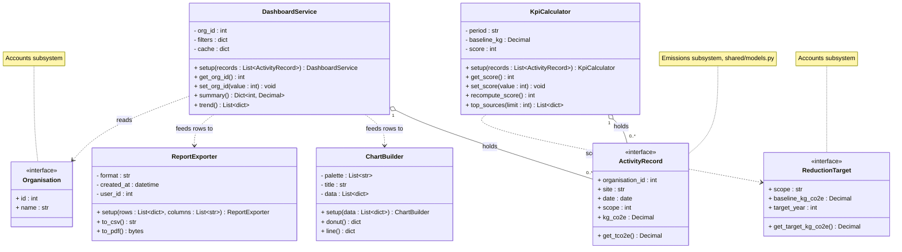
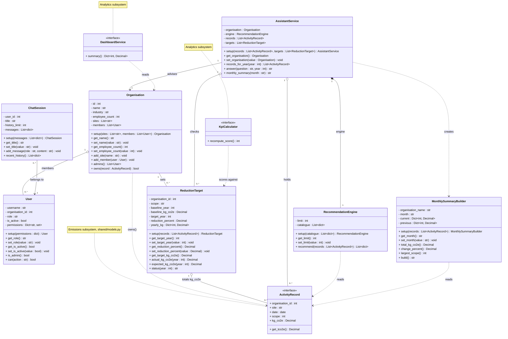
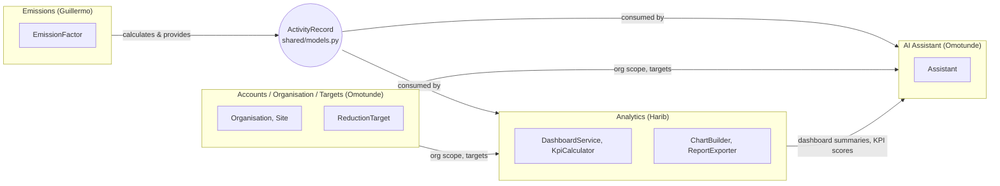

# CarbonDesk

## Team and project information

**Project:** CarbonDesk, Enterprise Carbon Footprint Tracker & AI Assistant
**Course:** Python Capstone Project, M.Sc. Digital Transformation, FH Dortmund
**Lecturer:** Prof. Galyna Tabunshchyk
**Semester:** Winter 2026/27

CarbonDesk is a web platform that helps small and medium companies measure their
Scope 1, 2 and 3 greenhouse gas emissions. Users record business activities such as
fuel use, electricity and business travel, which are converted to CO2e with traceable
emission factors. A dashboard shows where emissions come from and how they change over
time, reduction targets are tracked per scope, and an AI assistant explains the results
and suggests practical ways to reduce emissions.

**Tech stack:** Python 3.13, Django, Django REST Framework, NiceGUI, Plotly,
PostgreSQL / MySQL / SQLite, OpenAI API, Docker, pytest

### Team overview

| Name | Matriculation no. | Subsystem |
|---|---|---|
| Harib Khalid | 7225862 | Analytics Dashboard & Reporting |
| Guillermo Pérez Pérez | [to be added] | Emissions Data & Calculation |
| Omotunde Sholola Ganiyu | 7227720 | Users, Organisation & Targets; AI Sustainability Assistant |

CarbonDesk is our Compact Programming capstone project at FH Dortmund. We are
building a web platform for small and medium companies to track Scope 1, 2,
and 3 carbon emissions, view their results, and get AI suggestions for reducing
their footprint.

## Planned stack

| Technology | Purpose |
| --- | --- |
| Python | Main language for the backend and frontend. |
| Django | Backend logic, data validation, authentication, permissions, and database models through its ORM. |
| NiceGUI | Web interface with activity forms, CSV uploads, tables, dashboards, and an assistant chat. |
| PostgreSQL | Shared database for organisations, activity records, emission factors, targets, and chat history. |
| Plotly | Interactive emissions charts and trends. |
| OpenAI API | Explanations and reduction suggestions based on company emissions data. |
| Docker Compose | Run the application components and database together. |
| pytest | Automated tests for calculations and application behavior. |

Django handles the business rules and data access; NiceGUI provides the user
interface.

## Who does what

| Team member | Subsystem | Main responsibilities |
| --- | --- | --- |
| Guillermo Pérez Pérez | Emissions Data & Calculation | Activity entry and CSV import, input validation, emission factors, and conversion to kg CO2e. |
| Harib Khalid | Analytics Dashboard & Reporting | Charts, KPIs, filters, target progress, and PDF/CSV reports. |
| Omotunde Sholola Ganiyu | AI Sustainability Assistant | Company-data chat, reduction recommendations, savings estimates, and monthly summaries. |
| Omotunde Sholola Ganiyu | Users, Organisation & Targets | Login and roles, company structure, yearly reduction targets, alerts, and audit history. |

The team coordinates shared data models and interfaces so the subsystems work
together.

## Project structure

```text
backend/
  config/          Django settings and root URLs
  core/            Shared health endpoint
  emissions/       Guillermo: activity records and calculations
  analytics/       Harib: summaries and reports
  assistant/       Omotunde: AI services
  accounts/        Omotunde: users, organisations and targets
frontend/
  pages/           Matching NiceGUI pages for each subsystem
  api.py           Server-side HTTP calls to Django
  layout.py        Shared navigation and page layout
requirements/      Backend and frontend dependencies
compose.yaml       Local Docker setup
compose.dev.yaml   Optional source mounts and automatic reload
```

Each Django subsystem has `models.py`, `services.py`, `views.py`, and `urls.py`.
Keep calculations and business rules in backend services. The frontend calls
Django through HTTP and must not access the database directly. The shared
`GET /api/health/` endpoint is the first working connection between them.

## Run with Python

Use **Python 3.13** and standard `venv`/`pip`. Run commands from the repository
root. No uv installation is required.

```bash
python3.13 -m venv .venv
source .venv/bin/activate
python -m pip install -r requirements-dev.txt
cp .env.example .env
python backend/manage.py migrate
python backend/manage.py runserver
```

On Windows PowerShell, replace the environment creation, activation, and copy
commands with:

```powershell
py -3.13 -m venv .venv
.\.venv\Scripts\Activate.ps1
Copy-Item .env.example .env
```

Open a second terminal, activate the same environment, and start the frontend:

```bash
python -m frontend.main
```

- Frontend: http://localhost:8080
- Backend health: http://localhost:8000/api/health/
- Django admin: http://localhost:8000/admin/

The Python setup uses SQLite by default. To use an existing PostgreSQL database,
set `DB_ENGINE=postgresql` and the `POSTGRES_*` values in `.env` before migrating.
The frontend reads `BACKEND_URL` from `.env`. Environment variables take priority.

To create a local admin account:

```bash
python backend/manage.py createsuperuser
```

## Run with Docker Compose

Install Docker with the Compose plugin (Docker Desktop includes it). From the
repository root:

```bash
cp .env.example .env
docker compose up --build
```

On Windows use `Copy-Item .env.example .env`. Keep an existing `.env` rather than
copying over your settings. Compose starts PostgreSQL, applies Django migrations,
and starts the backend and frontend. The same browser URLs above apply.
PostgreSQL data and uploaded files use named volumes. The database is only
accessible inside the Compose network.

For automatic reload while editing Python files:

```bash
docker compose -f compose.yaml -f compose.dev.yaml up --build
```

Useful commands:

```bash
docker compose exec backend python manage.py createsuperuser
docker compose exec backend python manage.py makemigrations
docker compose exec backend python manage.py migrate
docker compose logs -f
docker compose down
```

`docker compose down` keeps the data volumes. Adding `--volumes` deletes them.
Stop the Python servers before starting Compose to avoid port conflicts.
These Docker files are for local development and demos: they use Django's
development server and local credentials, not a production deployment.

## Working together

- Add models and business logic in your Django subsystem and UI in the matching
  `frontend/pages/` module. Coordinate changes to shared models and settings.
- After changing models, run `python backend/manage.py makemigrations`, then
  `python backend/manage.py migrate`. Commit the generated migrations.
- Keep dependency changes in the appropriate `requirements/` file and reinstall
  with `python -m pip install -r requirements-dev.txt`.
- Keep secrets in `.env`; it is ignored by Git. Add new configuration names with
  safe example values to `.env.example`.
- Agree authentication and organisation checks before exposing company data.
  The starter health endpoint is public and contains no company data.

Run checks from an activated environment:

```bash
python backend/manage.py check
python -m pytest
python -m ruff check .
python -m ruff format --check .
```

## Current status

Implemented: **Users, Organisation & Targets** and the **AI Sustainability
Assistant**. The emissions page now supports factor creation, activity entry,
CSV import, calculation previews, filtered records, and totals. The dashboard at
http://localhost:8080/dashboard shows KPIs, emissions by scope, a monthly trend,
emissions by site, the top sources and target progress, with filters and a CSV
export. PDF reports are still to come.

- Register a company at http://localhost:8080/register; you become its administrator.
- Roles: `admin` manages the organisation, members and targets; `editor` enters
  data; `viewer` has read-only access.
- No OpenAI key is needed. Without `OPENAI_API_KEY` the assistant answers from
  rules; savings estimates are always calculated by the backend, not the model.

### Shared building blocks for every subsystem

- **API style:** Django REST Framework with token authentication. Every endpoint
  requires login by default. The frontend sends the token through `frontend/api.py`
  (`await api.get("emissions/...")`), which raises `ApiError` with a readable message.
- **Company data isolation:** combine `accounts.mixins.OrganisationScopedMixin` with a
  permission from `accounts.permissions` (for example `CanEditDataOrReadOnly`). The
  mixin filters querysets by `organisation`, attaches new records to the user's
  organisation and writes the audit history automatically.
- **Emissions totals:** targets and the assistant read emissions through
  `core/emissions_data.py`. The emissions subsystem provides
  `emissions.services.totals_by_scope(organisation, start, end)`, returning
  `{1: Decimal, 2: Decimal, 3: Decimal}` in kg CO2e from saved activities.
  The date range includes `start` and excludes `end`.

### Main endpoints

| Area | Endpoints under `/api/` |
| --- | --- |
| Authentication | `accounts/register/`, `accounts/login/`, `accounts/logout/`, `accounts/me/` |
| Organisation | `accounts/organisation/`, `accounts/sites/`, `accounts/members/` |
| Targets & alerts | `accounts/targets/`, `accounts/targets/evaluate/`, `accounts/alerts/`, `accounts/audit-log/` |
| Emissions | `emissions/factors/`, `emissions/activities/`, `emissions/activities/import/`, `emissions/preview/`, `emissions/summary/` |
| Analytics | `analytics/dashboard/`, `analytics/export/csv/` (both accept `start`, `end`, `scope`, `site`) |
| Assistant | `assistant/conversations/`, `assistant/conversations/<id>/messages/`, `assistant/recommendations/`, `assistant/summaries/` |

Implemented UML diagrams and the team presentation video link will be added as
development progresses.

## First emissions workflow

1. Apply migrations with `python backend/manage.py migrate` (Compose applies them
   at startup). Register a company or log in with its admin/editor account.
2. An administrator adds a site on the Organisation page.
3. On **Emissions → Emission factors**, add a factor with its name, scope, unit,
   value in kg CO2e per unit, source, and year.
4. Choose **Add activity**, select the site and factor, and enter the date and
   quantity. Preview the calculation, then save it. Alternatively, choose
   **Import CSV** to add many activities from one file.
5. Browse the records, filter by date/scope/site, and open **Details** to inspect
   the inputs used. Saved totals also feed the assistant and reduction targets.

For a reproducible example, use a separate demo organisation and add a factor
named **Demo electricity**, Scope 2, unit `kWh`, value `0.4`, source **Synthetic
example**, year `2026`. Select **This is a synthetic demo factor**. An activity
of `100 kWh` must preview and save as **40.00 kg CO2e**. These numbers are for
software testing, not an official emissions estimate. Demo records are labelled
on the emissions page but still contribute to company totals, including the
assistant and targets; keep demo activity separate from real company data.

### Endpoint behavior

- `GET/POST /api/emissions/factors/`: list or add company factors. Each new
  source/version is a separate factor; update/delete is not exposed yet.
- `POST /api/emissions/preview/`: send `factor`, `quantity`, and `unit`; receive
  `kg_co2e` without saving a record.
- `GET/POST /api/emissions/activities/`: list or create records. Creation accepts
  `description`, `date` (`YYYY-MM-DD`), `factor` ID, `site` ID, `quantity`, and
  `unit`. The backend assigns the company, creator, scope, and result.
- `GET /api/emissions/activities/<id>/`: inspect the original calculation inputs.
- `POST /api/emissions/activities/import/`: upload a CSV file in the `file`
  multipart field. The response reports how many records were created.
- `GET /api/emissions/summary/`: record count, demo count, total and scope totals.

Activity lists and summaries accept `start` (inclusive), `end` (exclusive),
`scope` (1–3), and `site`. Lists use 20 records per page and accept `page`.
Omitted date filters include all dates. Invalid filters return HTTP 400.
Admins/editors can add factors, add activities, and import CSV; viewers can read
and preview. All endpoints require an organisation membership. Cross-company IDs
are rejected.

Quantities must be non-negative and have at most four decimal places; factors
allow eight. Zero is valid. Units must match exactly: conversions are not implicit.
Activity dates cannot be in the future. The calculation uses `Decimal` and rounds
half up to **0.01 kg CO2e** once per record; totals sum those saved results.
Records preserve the factor name, scope, value, unit, source, year, and demo flag
used at creation. Writes use the existing audit log.

### CSV import

The **Import CSV** button accepts UTF-8 files with a header row. Required columns
are `date`, `description`, `site`, `factor`, `quantity`, and `unit`. The optional
`factor_year` column selects one version when several factors share a name. Dates
use `YYYY-MM-DD`; site and factor names must match the company exactly.

Validation is all-or-nothing: if any row fails, no records are saved and the
response lists each problem with its physical line number (up to 100 problems
are shown). Imports are limited to 5 MB and 5,000 data rows. Each imported record is calculated with the same
rules as manual entry and receives its own audit-log entry. The import does not
check for duplicate activities, so re-uploading a file creates the rows again.
A template is available from the import dialog.

Streaming, activity editing/deletion, factor-change recalculation, and department
links are follow-up work. This slice uses the existing PostgreSQL/SQLite setup;
MySQL support for Hometask 3 is still pending.

## Analytics — OOP design (Harib, Hometask 1)

`backend/analytics/domain.py` is a plain-Python model of the Analytics
subsystem: no Django imports, no database access, so it can be imported and
tested on its own. The Django-backed dashboard in `backend/analytics/services.py`
and `views.py` is unchanged; this module mirrors its design in framework-free
classes for the UML assignment.

`DashboardService` and `KpiCalculator` take the project's shared
[`ActivityRecord`](#shared-data-model-team-proposal) (`shared/models.py`)
instead of plain dicts, with the same field names as the Django model
(`backend.emissions.models.ActivityRecord`) and `stream_processing`'s
`ActivityEvent` use. `ChartBuilder` and `ReportExporter` still take plain dicts
on purpose: they format already-aggregated chart points and report rows, which
is a different thing from a raw activity record, not a second copy of the same
format.



Every attribute marked `-` is private, validated through an `@property`
getter/setter pair (shown above as `get_x()`/`set_x()`), not accessed directly
(for example, `KpiCalculator.score` must stay between 0 and 100,
`ChartBuilder.palette` must be non-empty hex colors, and `ActivityRecord.tco2e` /
`ReductionTarget.target_kg_co2e` are read-only computed properties). `+`
attributes and operations are the public surface. `ActivityRecord`,
`Organisation`, and `ReductionTarget` are external interfaces this subsystem
depends on but doesn't own - see the note on each. Tests live in
`backend/analytics/tests/test_domain.py` and run without a database:
`python -m pytest backend/analytics/tests/test_domain.py`.

## Users, Organisation & Targets and AI Assistant — OOP design (Omotunde, Hometask 1)

`backend/accounts/domain.py` and `backend/assistant/domain.py` are plain-Python
models of Omotunde's two subsystems: no Django imports, no database access and no
OpenAI calls, so they can be imported and tested on their own. The Django models,
services and views are unchanged; these modules mirror their rules in
framework-free classes for the UML assignment.

Activity data always arrives as the project's shared
[`ActivityRecord`](#shared-data-model-team-proposal) (`shared/models.py`, kg CO2e):
`ReductionTarget.setup()` totals `kg_co2e` per year from it, and every assistant
class reads it. The assistant uses the accounts classes (`Organisation`,
`ReductionTarget`) directly, so the two subsystems share one interface instead of
passing their own dicts. Recommendations and chat messages stay plain dicts on
purpose: they are the assistant's outputs, not a second format for activity data.



Every attribute marked `-` is private and is read and changed only through an
`@property` getter/setter pair (shown as `get_x()`/`set_x()`) that validates the
value and raises `ValueError` or `TypeError`. For example, `User.role` must be
`admin`, `editor` or `viewer`; `ReductionTarget.target_year` must come after
`baseline_year`; `Organisation.add_member()` refuses users of another organisation;
`ChatSession` rejects empty or over-long messages; and `MonthlySummaryBuilder.month`
must look like `YYYY-MM`. `get_target_kg_co2e()` is a read-only computed property.
Each `setup()` loads what the object works on: permissions, sites and members,
`ActivityRecord` lists, the measure catalogue or earlier chat messages.
`ActivityRecord`, `KpiCalculator` and `DashboardService` are interfaces owned by
other subsystems (see the notes). Analytics reads this subsystem's
`ReductionTarget` and `Organisation`.

Tests run without a database:

```bash
python -m pytest backend/accounts/tests/test_accounts_domain.py backend/assistant/tests/test_assistant_domain.py
```

## Shared data model (team proposal)

Our professor's feedback was that the project has too many different data
formats for the same thing, and no connected concept of the system across
subsystems. For Analytics, one activity record existed in three shapes: the
Django model `backend.emissions.models.ActivityRecord` (`kg_co2e`), plain dicts
here in `backend/analytics/domain.py`, and the `ActivityEvent` dataclass in
`stream_processing/base.py` (Hometask 2, separate branch).

`shared/models.py` is a proposal to fix that: one plain-Python `ActivityRecord`
dataclass with field names that match the Django model exactly
(`organisation_id`, `site`, `date`, `scope`, `category`, `quantity`, `unit`,
`factor_value`, `kg_co2e`), storing emissions in kg CO2e everywhere with a
read-only `tco2e` property for metric tons. It has no Django dependency, so any
subsystem can import it (`pythonpath = ["backend", "."]` already makes
`shared.models` importable from both `backend/` and other top-level packages).

`DashboardService` and `KpiCalculator` above now use these exact field names, so
an activity record means the same thing wherever it shows up in Analytics code.
**Proposal for the team:** Emissions and Accounts/AI Assistant code should read
and write the same shape instead of their own dicts/tuples, so the whole
project - not just Analytics - agrees on one format for an activity record.

## System architecture (team proposal)

**This section is a proposal for the whole team, not yet implemented outside
Analytics.** It responds to the feedback that the subsystems' interfaces aren't
connected into one system concept.



Emissions calculates and owns `ActivityRecord` (quantity, factor, `kg_co2e`);
Analytics and the AI Assistant only ever consume it, through the shared shape
above, instead of each inventing their own copy. Accounts/Targets provides the
organisation scope and reduction targets that Analytics and the AI Assistant
read but don't own. This diagram is deliberately at the subsystem level, not
the class level - see the class diagram above for the class-level UML within
Analytics, including the `<<interface>>` boxes for `ActivityRecord`,
`Organisation`, and `ReductionTarget`.
